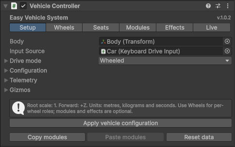

.. _uvs-configuration--vehicle-configuration:

Vehicle configuration
=====================

.. _uvs-configuration--add-a-vehicle-or-component:

Add a vehicle or component
--------------------------

Select a scene GameObject or an object in Prefab Mode, then use **Tools > UltraVehicleSystem > Add Vehicle**. Choose a :doc:`drive profile </DriveProfiles>` for the vehicle.

Setup adds the profile's relevant mechanics, input adapter and presentation components. Existing owned WheelColliders can populate Wheel Setup; review every role and reference. You must supply body colliders, model geometry, hinges, seat/control anchors, light objects, effect outlets and other model-specific bindings.

Wheel presets assign package-owned tire smoke, loose-ground and skidmark resources; engine presets also assign exhaust smoke. These defaults work without Demo. Assign model-specific exhaust outlets yourself; see :doc:`Particles </Particles>` and :doc:`Tire marks </Decals>`.

Repeating the same preset preserves existing tuning/references and adds missing components. Choosing a different profile initializes that profile and its initial vehicle Configuration. Setup changes support grouped Undo. Open prefab assets in Prefab Mode before using scene setup tools.

Use **Component > UltraVehicleSystem** or **Tools > UltraVehicleSystem > Add Component** for model-mounted helpers and standalone components. The controller's **Add module** menu adds registered mechanics; custom VehicleModule subclasses appear under **Custom**. Handles are configured under Seats rather than the module scheduler.

.. _uvs-configuration--identifier-naming:

Identifier naming
-----------------

The supplied vehicles, presets and examples use PascalCase IDs such as ``SteeringWheel``, ``Driver``, ``Drive``, ``Wiper1`` and ``WheelFrontLeft``. Use the same exact ID wherever a control, profile, seat, sound or part is referenced. IDs remain case-sensitive; lookup APIs do not automatically rename custom IDs.

.. _uvs-configuration--controller-tabs:

Controller tabs
---------------

+---------+---------------------------------------------------------------------------------------------------------------+
| Tab     | Purpose                                                                                                       |
+=========+===============================================================================================================+
| Setup   | Body/input references, drive profile, **Configuration**, **Telemetry** and module copy/paste/reset            |
+---------+---------------------------------------------------------------------------------------------------------------+
| Wheels  | Central Wheel Setup list, discovery and per-wheel geometry/roles                                              |
+---------+---------------------------------------------------------------------------------------------------------------+
| Seats   | Passenger core, seats, occupants and a collapsible **Handles** group                                          |
+---------+---------------------------------------------------------------------------------------------------------------+
| Modules | Category groups, local/category ordering and embedded module inspectors                                       |
+---------+---------------------------------------------------------------------------------------------------------------+
| Effects | Optional presentation systems and audio channels                                                              |
+---------+---------------------------------------------------------------------------------------------------------------+
| Live    | Diagnostic command, sensor, body, powertrain, contact and per-wheel readings, plus available runtime controls |
+---------+---------------------------------------------------------------------------------------------------------------+

Click **Apply vehicle configuration** after persistent configuration or wheel-geometry changes. Validation rejects missing/duplicate wheel colliders and wheels owned by another Rigidbody. Non-wheel profiles can use an empty list.

.. _uvs-configuration--live-diagnostics:

Live diagnostics
----------------

In Play Mode, open **Live** on the Vehicle Controller. The read-only diagnostic sections show:

+-----------------------------------------+-------------------------------------------------------------------------------------------------------------------------------------------------------------------------------------------------------------------+
| Section                                 | Readings                                                                                                                                                                                                          |
+=========================================+===================================================================================================================================================================================================================+
| Overview                                | Physics sample time/step, input source, physical/direct control, speed and grounded wheels                                                                                                                        |
+-----------------------------------------+-------------------------------------------------------------------------------------------------------------------------------------------------------------------------------------------------------------------+
| Current command and resolved controls   | Throttle, steering, brake, clutch, pitch/roll/yaw, lift/strafe, analog/digital channels, handbrake and action/switch requests; resolved throttle, brake and steering angle                                        |
+-----------------------------------------+-------------------------------------------------------------------------------------------------------------------------------------------------------------------------------------------------------------------+
| Motion, sensors and body                | World/local velocity and acceleration, angular velocity, specific force, gravity, G loads, attitude, altitude, vertical speed, still-air airspeed, ground clearance, mass, centre of mass, inertia and body state |
+-----------------------------------------+-------------------------------------------------------------------------------------------------------------------------------------------------------------------------------------------------------------------+
| Engine, transmission and fuel           | Running state, RPM, torque, gear/mode/ratio, shifting, wheel RPM, clutch engagement/slip, fuel and consumption                                                                                                    |
+-----------------------------------------+-------------------------------------------------------------------------------------------------------------------------------------------------------------------------------------------------------------------+
| Last body contact and impact            | Last recorded contact/impact time, collider, point, normal, relative velocity, impulse and mean impact force                                                                                                      |
+-----------------------------------------+-------------------------------------------------------------------------------------------------------------------------------------------------------------------------------------------------------------------+
| Wheel contact, suspension and actuation | Attachment/operational/contact states, wheel roles, RPM, surface speed, steering, motor/brake torque, suspension extension/travel/compression, contact load, slip, wheel/contact position and normal              |
+-----------------------------------------+-------------------------------------------------------------------------------------------------------------------------------------------------------------------------------------------------------------------+

Automatic refresh is limited to 10 Hz, only while the Inspector displays **Live** in unpaused Play Mode. Other controller tabs do not request automatic refresh. Closed sections skip drawing their detailed rows. The view reads existing ``Telemetry`` snapshots and cached ``VehicleSensors``; it adds no physics queries, event subscriptions or per-vehicle runtime sampler. Normal Inspector redraws can still occur when interacting with the editor. Pause retains inspectable values.

Force estimates are explicitly labelled: net force is sampled acceleration × mass; non-gravity force is specific force × mass. These estimates are not a sum of actuator forces, and direct control reports commanded motion. Wheel contact load comes from the wheel ground hit. Mean impact force uses collision impulse over its physics interval. Last-contact/impact values are historical, not proof of ongoing contact. One-shot commands may pass between Inspector refreshes; use ``CommandSampled`` for a complete command trace. Telemetry marks the end of the controller pipeline, before Unity's subsequent native physics simulation.

.. _uvs-configuration--coordinate-system-and-units:

Coordinate system and units
---------------------------

Keep the root at unit scale, facing local +Z with +Y up. Put imported mesh scaling on visual children where practical. Mass is kilograms; distance/travel is metres; torque is N·m; rates and angular limits use the units shown by each field. Open **Vehicle Controller > Setup > Configuration** for the shared vehicle tuning. The C# configuration remains available through ``vehicle.settings``. ``settings.centerOfMass`` is an explicit local center-of-mass position relative to the root.

.. _uvs-configuration--wheel-setup:

Wheel Setup
-----------

For a complete first-time walkthrough, including adding **Wheel** to each tire object, see :ref:`Create your first wheel vehicle <uvs-gettingstarted--create-your-first-wheel-vehicle>`.

Each entry supplies its WheelCollider, wheel visual and optional caliper visual; availability; Steer, Drive, Brake and Handbrake flags; radius, width and mass; and steering, drive and braking multipliers. Wheel count is configurable. Negative steering multipliers support counter-steering axles. Driven-wheel weights control base torque allocation.

Author through Wheel Setup and read the runtime adapters through ``Wheels``. Once a WheelCollider is listed in Wheel Setup, its Wheel component shows the controller-managed fields as read-only. Edit these values in the vehicle’s Wheels tab and apply the configuration. The Wheel Inspector displays the last applied values; local visual suspension smoothing remains editable. Unassigned Wheel components remain editable, including when they are beneath a vehicle but not in its Wheel Setup. Each WheelCollider must belong to this vehicle’s Rigidbody and occur once in the list. Scene gizmos preview tire radius/width from the authoring data.

:doc:`Contact envelope </ContactEnvelope>`, :doc:`Tire collision </TireCollision>`, :doc:`Suspension </Suspension>` and :doc:`Traction control </TractionControl>` explain the corresponding optional mechanics.

.. _uvs-configuration--configure-modules-independently:

Configure modules independently
-------------------------------

Use a component's enabled checkbox to stop its scheduled behavior, and internal switches for individual features. Existing native settings or already detached objects may persist; disabling a script is not a full vehicle reset. Root modules have embedded inspectors; **Modules > Show standalone module inspectors** controls whether their ordinary Unity inspectors are also shown. Child components remain available on their own objects. The preference does not change enabled state.

Audio channels are grouped beneath Audio. Passenger behaviours are owned by Passengers. If their parent is absent, orphaned components are shown in a **parent missing** group. Nested vehicles do not inherit a parent's core.

Choose execution phase/local order in custom code when required. Inspector local-order overrides and category order can be applied without resetting mechanics through ``RefreshModuleOrder()``. See :doc:`Architecture </Architecture>`.

.. _uvs-configuration--connect-references:

Connect references
------------------

Assign model geometry, control targets and assets explicitly. ``ConnectAvailableModules()`` fills missing local module/controller references while preserving explicit assignments. For automatic setup policies and custom modules, see :doc:`Scripting </Scripting>`.

.. _uvs-configuration--copy-paste-and-reset:

Copy, paste and reset
---------------------

**Copy modules** captures the controller and its owned VehicleModule components, including disabled and child modules. **Paste modules** replaces the destination module layout/settings and remaps vehicle-local references to corresponding destination objects. Shared assets/external references stay shared; missing destinations stay empty. Geometry, nested vehicles and unrelated components are not copied. Missing module holders can be created without duplicating a model.

These actions are available outside Play Mode and support Undo. The clipboard lasts until scripts reload. **Reset data** asks for confirmation, restores component defaults and clears authored references while keeping component layout and unrelated objects. Unity's ordinary component Copy applies to that component alone.

See :doc:`Inspector controls </InspectorConfiguration>` for subsystem settings and :doc:`Vehicle tuning </VehicleTuning>` for physical tuning.

.. _uvs-configuration--scene-gizmo-visibility:

Scene gizmo visibility
----------------------

Components that draw scene guides expose a collapsible **Gizmos** section in their Inspector, including the component panels inside Vehicle Controller. **Show gizmos** is the master switch. Expand the section to enable or disable the individual parts listed below. New options default to enabled, so existing scenes keep their appearance. Existing master switches and category preferences keep their saved values. Unity’s Scene view Gizmos menu and the original selection requirements still apply.

.. _uvs-configuration--component-visibility-controls:

Component visibility controls
~~~~~~~~~~~~~~~~~~~~~~~~~~~~~

These settings belong to each component, are saved in scenes/prefabs and support Undo. Changing one component’s options does not change another component’s options. Only relevant controls appear in each Inspector.

+-------------------------------------------------------------------------+-------------------------------------------------------------------------------------------+-------------------------------------------------------------------------------------------------------------------------------------------------------------------------------+
| Component                                                               | Separate controls                                                                         | What they affect                                                                                                                                                              |
+=========================================================================+===========================================================================================+===============================================================================================================================================================================+
| Vehicle Controller                                                      | Show wheels, Show center of mass, Show labels                                             | Tire radius/width previews, the chassis mass marker, and text annotations. Turning off wheels leaves the mass marker available.                                               |
+-------------------------------------------------------------------------+-------------------------------------------------------------------------------------------+-------------------------------------------------------------------------------------------------------------------------------------------------------------------------------+
| Wheel                                                                   | Show geometry, Show labels                                                                | This wheel’s tire preview and width label. A registered wheel also respects its controller’s wheel and label switches.                                                        |
+-------------------------------------------------------------------------+-------------------------------------------------------------------------------------------+-------------------------------------------------------------------------------------------------------------------------------------------------------------------------------+
| Passenger Seat                                                          | Show pelvis, Show hands, Show feet, Show exit                                             | Backrest/pelvis, paired hand anchors, paired foot anchors and the exit point.                                                                                                 |
+-------------------------------------------------------------------------+-------------------------------------------------------------------------------------------+-------------------------------------------------------------------------------------------------------------------------------------------------------------------------------+
| Seat Access                                                             | Show clearance, Show connections                                                          | The outside character-clearance sphere and the route connecting outside, doorway and seat.                                                                                    |
+-------------------------------------------------------------------------+-------------------------------------------------------------------------------------------+-------------------------------------------------------------------------------------------------------------------------------------------------------------------------------+
| Adaptive Hand Grip                                                      | Show bones, Show pads                                                                     | Finger skeleton lines and contact pad spheres. The steering-wheel Show finger contacts option remains an additional gate for linked grips.                                    |
+-------------------------------------------------------------------------+-------------------------------------------------------------------------------------------+-------------------------------------------------------------------------------------------------------------------------------------------------------------------------------+
| Steering Wheel Handle and derived grips                                 | Show geometry, Show anchors, Show axes, Show labels, Show editing handles                 | Rim shape, palm contact points, palm orientation, dimensions and interactive rim editing. Stick grips use their cylindrical grip preview and radius editing.                  |
+-------------------------------------------------------------------------+-------------------------------------------------------------------------------------------+-------------------------------------------------------------------------------------------------------------------------------------------------------------------------------+
| Other Vehicle Handles                                                   | Show geometry, Show labels, Show editing handles                                          | Grip shape/dimensions and radius editing where an adaptive grip exists. Switch Handle additionally exposes its motion axes and ranges.                                        |
+-------------------------------------------------------------------------+-------------------------------------------------------------------------------------------+-------------------------------------------------------------------------------------------------------------------------------------------------------------------------------+
| Aircraft Control Motion, Stick Setup, Throttle Setup, Landing Gear Part | Show anchors, Show axes, Show ranges, Show labels, Show editing handles                   | Neutral pivot/palm markers, axes, angle/translation limits, annotations and interactive anchor positioning. These switches do not alter motion or Inspector preview controls. |
+-------------------------------------------------------------------------+-------------------------------------------------------------------------------------------+-------------------------------------------------------------------------------------------------------------------------------------------------------------------------------+
| Rotary Handle, Gear Paddle Handle                                       | Show axes, Show ranges, Show labels                                                       | Rotation axis, permitted angular sweep and end-angle text.                                                                                                                    |
+-------------------------------------------------------------------------+-------------------------------------------------------------------------------------------+-------------------------------------------------------------------------------------------------------------------------------------------------------------------------------+
| Wiper Blade                                                             | Show anchors, Show axes, Show ranges, Show labels                                         | Pivot marker, axis/travel arrows, swept arc/end-pose previews and angle labels.                                                                                               |
+-------------------------------------------------------------------------+-------------------------------------------------------------------------------------------+-------------------------------------------------------------------------------------------------------------------------------------------------------------------------------+
| Landing Gear Suspension Part                                            | Show axes, Show ranges, Show labels                                                       | Hinge direction, opening-angle arc and unloaded/limit labels.                                                                                                                 |
+-------------------------------------------------------------------------+-------------------------------------------------------------------------------------------+-------------------------------------------------------------------------------------------------------------------------------------------------------------------------------+
| Suspension Hub                                                          | Show anchors, Show connections                                                            | The suspension endpoints and the line between them.                                                                                                                           |
+-------------------------------------------------------------------------+-------------------------------------------------------------------------------------------+-------------------------------------------------------------------------------------------------------------------------------------------------------------------------------+
| Suspension Axle                                                         | Show anchors, Show connections, Show labels, Show editing handles                         | Endpoint markers, joining line, anchor names and interactive anchor positioning.                                                                                              |
+-------------------------------------------------------------------------+-------------------------------------------------------------------------------------------+-------------------------------------------------------------------------------------------------------------------------------------------------------------------------------+
| Shock Absorber, Half Shaft, Control Arm                                 | Show anchors, Show connections, Show ranges, Show labels, Show editing handles            | Mount markers/links, length or angular limits, measurements and interactive anchor positioning.                                                                               |
+-------------------------------------------------------------------------+-------------------------------------------------------------------------------------------+-------------------------------------------------------------------------------------------------------------------------------------------------------------------------------+
| Steering Tie Rod                                                        | Show anchors, Show connections, Show axes, Show ranges, Show labels, Show editing handles | Rack/rod endpoints, links, kingpin axis, rack/steering limits, measurements and anchor editing.                                                                               |
+-------------------------------------------------------------------------+-------------------------------------------------------------------------------------------+-------------------------------------------------------------------------------------------------------------------------------------------------------------------------------+
| Track Path Builder                                                      | Show path, Show labels                                                                    | The proposed track loop and point indices.                                                                                                                                    |
+-------------------------------------------------------------------------+-------------------------------------------------------------------------------------------+-------------------------------------------------------------------------------------------------------------------------------------------------------------------------------+
| Demo External Control                                                   | Show entry route, Show driving route, Show point markers, Show connections                | The approach/main AI routes, checkpoint spheres and connecting lines.                                                                                                         |
+-------------------------------------------------------------------------+-------------------------------------------------------------------------------------------+-------------------------------------------------------------------------------------------------------------------------------------------------------------------------------+

**Show labels** controls text independently of the geometry switches. **Show editing handles** hides interactive Scene view controls while leaving ordinary Inspector fields editable. All visibility controls affect presentation only: they do not disable physics, occupancy, IK, driving or mechanical motion. Hiding an anchor does not remove or move its transform.

.. _uvs-configuration--shared-category-controls:

Shared category controls
~~~~~~~~~~~~~~~~~~~~~~~~

Moving parts, weapons, recoil, rockets and track visuals retain their category preferences. Their **Gizmos** sections affect matching components across the Editor and are not stored in a particular prefab. Label, size, selection and trajectory preferences apply to the matching gizmos.

+---------------+----------------------------------------------------------------------------------------------------------------------------+
| Category      | Separate controls                                                                                                          |
+===============+============================================================================================================================+
| Moving parts  | Anchor marker, rotation axis, anchor connection, motion limits, neutral direction, current direction and target direction. |
+---------------+----------------------------------------------------------------------------------------------------------------------------+
| Weapons       | Muzzle marker, shot/up directions and trajectory preview.                                                                  |
+---------------+----------------------------------------------------------------------------------------------------------------------------+
| Recoil        | Animated barrel travel and hull impulse direction.                                                                         |
+---------------+----------------------------------------------------------------------------------------------------------------------------+
| Rockets       | Launch direction, exhaust direction, launcher connections, trajectory preview and blast radius.                            |
+---------------+----------------------------------------------------------------------------------------------------------------------------+
| Track visuals | Left track, right track, rollers, roller axes, path point markers and travel arrows.                                       |
+---------------+----------------------------------------------------------------------------------------------------------------------------+

Shared **Show labels** remains independent of these geometry choices. Trajectory duration and gizmo size remain adjustable where supported. Blast-radius preview is off by default; category visibility switches are on by default.
