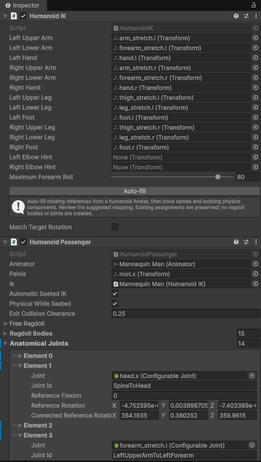
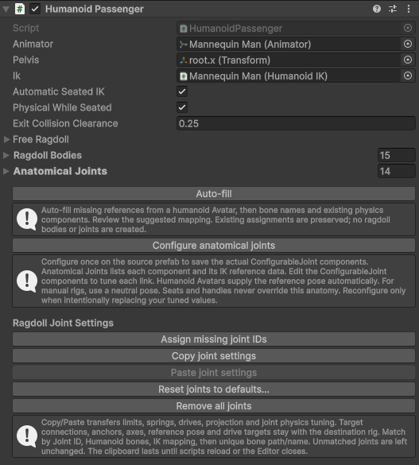

.. _uvs-humananatomy--prepare-a-humanoid-ragdoll:

Prepare a humanoid ragdoll
==========================

Prepare the character in this order: **rig and Avatar → ragdoll bodies/colliders → reference auto-fill → anatomical joint conversion → seat and contact setup**. Work outside Play Mode and save the completed character as a reusable prefab.

The package's anatomical parts are the physical bones and their saved ``ConfigurableJoint`` connections, listed under **Humanoid Passenger → Anatomical Joints**. Hand/foot anchors on a vehicle are separate: they tell the seated character where to reach, rather than defining its skeleton.

.. _uvs-humananatomy--1-prepare-the-rig:

1. Prepare the rig
------------------

1. Import a skinned character with a bone hierarchy. Select the model asset in the Project window and open its **Rig** import settings.
2. Set **Animation Type** to **Humanoid**, create or assign a valid Avatar, and apply the import settings. Use **Configure** to review hips, spine, head, arms and legs; correct left/right mapping and the reference pose before continuing.
3. Keep the bones needed for ragdoll bodies and IK accessible in the hierarchy. If import optimization hides them, expose the required transforms or disable **Optimize Game Objects** for this setup.
4. Drag the character into a scene and create your own character prefab or prefab variant. Make changes on this instance or in Prefab Mode, rather than attempting to modify the imported model file itself.
5. Check the character's real size and forward direction. Keep its working root at unit scale and avoid nonuniform scaling of physical bones. Finish proportion changes before authoring the joints.

A valid Humanoid Avatar supplies the reference mapping automatically. A custom/manual rig can also be configured, but its pelvis, limb bones and body connections must be assigned explicitly, and it must be placed in a neutral pose before anatomical configuration.

.. _uvs-humananatomy--2-create-the-physical-ragdoll:

2. Create the physical ragdoll
------------------------------

1. Expand the character instance's skeleton in the Hierarchy.
2. Open **GameObject → 3D Object → Ragdoll...**. This is Unity's built-in `Ragdoll Wizard <https://docs.unity.com/en-us/engine/6000.0/manual/physics-section/physics-overview/ragdoll/wizard-ragdoll-wizard>`__.
3. Assign the instance's bone transforms to the wizard's body-part fields. If your Unity version provides an Animator field and **Auto-Fill**, assign this character's Animator first and review the generated mapping; otherwise drag the bones from the Hierarchy.
4. Check pelvis/root, torso/head and both arm/leg chains, set the intended body mass, then choose **Create**.
5. Inspect the generated ``Rigidbody``, collider and ``CharacterJoint`` components on the bones. Fit the colliders to the limbs and torso, check the mass distribution, and confirm that joints connect to the intended parent bodies.
6. Keep this skeleton separate from the vehicle hierarchy while preparing it. The ragdoll body list should contain the character's physical bones, not the car's Rigidbody or unrelated props.

If your character already has a suitable physical ragdoll, keep its existing bodies/colliders and continue below. The package's Auto-fill does not create them.

.. _uvs-humananatomy--3-add-passenger-components-and-auto-fill-references:

3. Add passenger components and auto-fill references
----------------------------------------------------

1. Select the character's working root, above its complete skeleton. Add **Humanoid Passenger** and **Humanoid IK** through Add Component; both are under **UltraVehicleSystem → Passengers → IK**.
2. In Humanoid Passenger, assign the character's **Animator** and **IK** if they are not found automatically.
3. Press **Auto-fill** on Humanoid Passenger. It fills missing Animator, IK and pelvis references and collects existing ragdoll Rigidbodies. It uses the Humanoid Avatar where available, then bone names and existing components.
4. Press **Auto-fill** on Humanoid IK and review both upper/lower arms, hands, upper/lower legs and feet. Assign unresolved references manually.
5. Review **Pelvis**, **Ragdoll Bodies** and the IK limb mapping. Existing assignments are preserved by Auto-fill, so correct or clear an incorrect reference yourself before filling it again.

There are two different auto-fill operations: the Unity wizard helps prepare the initial physical ragdoll; the package buttons connect that existing rig to its passenger and IK components. Neither package button converts joint types.

.. _uvs-humananatomy--4-convert-to-anatomical-configurablejoints:

4. Convert to anatomical ConfigurableJoints
-------------------------------------------

1. Keep the source character outside Play Mode. For a manual rig, put the skeleton into its neutral reference pose.
2. On **Humanoid Passenger**, press **Configure anatomical joints**.
3. Read the overwrite confirmation and choose **Overwrite settings** when you are ready to replace the rig's joint tuning.
4. The operation creates or updates the anatomical ``ConfigurableJoint`` connections, converts the corresponding ``CharacterJoint`` components, and saves their references and IK reference data in **Anatomical Joints**. Existing Rigidbodies and colliders are preserved.
5. Expand Anatomical Joints and follow each joint reference to its bone. Inspect **Connected Body**, anchors, axes and angular limits on the actual ConfigurableJoint component. The root pelvis may have no parent-body joint; not every Rigidbody needs a list entry.
6. Refine the saved joints for your character's proportions. Elbows and knees should bend in the expected direction; shoulders, hips, wrists and torso should have appropriate travel without pulling connected bones apart.
7. Save the prefab, or apply the intended instance overrides to your own prefab.

Default anatomical ranges and joint-axis conventions are described below; refine them for the character after generating the preset.

**Configure anatomical joints overwrites existing axes, limits and anatomical tuning.** Use it for initial authoring or an intentional rebuild after changing the skeleton. Once tuned, edit the saved ConfigurableJoint components directly instead of regenerating them every time a seat or grip changes. A physical humanoid needs valid saved anatomical joint references before Play Mode; seating does not generate this anatomy for you.

.. _uvs-humananatomy--5-connect-the-character-to-a-seat:

5. Connect the character to a seat
----------------------------------

The character is ready for vehicle fitting when its mapping, bodies and saved joints are valid. Continue with :ref:`Passengers <uvs-passengers--add-an-occupant>` for body/prefab assignment and :ref:`Seats <uvs-seats--fit-the-seated-body>` for vehicle-specific pelvis/chest and contact setup. Those guides own the seat instructions; do not rebuild anatomy to move a pedal or steering wheel.

This completes the initial setup procedure. The following tools are for managing an existing rig; they are not additional required setup steps.

.. _uvs-humananatomy--manage-joints:

Manage joints
-------------

At the bottom of the **Humanoid Passenger** Inspector, **Ragdoll Joint Settings** provides optional Edit Mode tools for joint IDs, copying, resetting and removal. Choose the operation you need; do not run all of them in sequence.

.. _uvs-humananatomy--identify-and-access-joints-by-id:

Identify and access joints by ID
~~~~~~~~~~~~~~~~~~~~~~~~~~~~~~~~

Each **Anatomical Joints** entry has an editable **Joint ID** immediately after **Joint**. Keep IDs unique within one Humanoid Passenger. Matching is case-sensitive and uses the complete string; empty, missing and duplicate IDs do not resolve.

**Configure anatomical joints** automatically names new entries from the connected parent bone to the joint's own bone, for example ``LeftForearmToLeftHand``. It prefers Humanoid Avatar roles, then manually assigned IK roles, then sanitized bone names. Generated collisions receive ``_2``, ``_3`` and so on. Reconfiguring preserves existing nonempty IDs for the same physical bone, including custom names. For an already tuned rig, **Assign missing joint IDs** fills empty IDs without rebuilding joints or changing their tuning. Demo mannequin prefabs already contain IDs.

Use HumanoidPassenger.GetAnatomicalJoint / TryGetAnatomicalJoint to retrieve the native component, or UpdateAnatomicalJoint to edit it and refresh cached anatomical limits used by IK. TryGetAnatomicalJointDefinition exposes the saved entry and its reference data. Lookup scans the small list without allocations, so changing an ID or replacing the list in code takes effect immediately. See :ref:`joint ID scripting <uvs-scripting-anatomy--modify-a-joint-by-id>`.

.. _uvs-humananatomy--copy-joint-tuning-between-ragdolls:

Copy joint tuning between ragdolls
~~~~~~~~~~~~~~~~~~~~~~~~~~~~~~~~~~

1. Select the tuned source passenger and press **Copy joint settings**. The clipboard captures values from all ConfigurableJoint components owned by that passenger, including inactive bones. Nested passengers are excluded. Later edits to the source do not alter the snapshot.
2. Select another passenger and press **Paste joint settings**. Matching prefers matching Joint IDs, then Humanoid Avatar bone roles, then assigned passenger/IK roles, then unique relative paths and bone names. Different bone names work when both rigs have the same Humanoid or IK mapping. Prepare those mappings before pasting.
3. Review the reported applied/unmatched counts. Unmatched or ambiguous joints retain their existing settings; the tool never guesses by array order. A target without ConfigurableJoint components first generates its own anatomical joints from its Rigidbody skeleton. It does not create missing Rigidbody or Collider components.

Transferred settings include linear/angular motion modes, complete limits and limit springs, linear/angular drives, rotation drive mode, projection, break thresholds, collision/preprocessing flags and mass scales. Connections, anchors, axes, world/local drive frames, target positions/rotations/velocities and anatomical reference-pose metadata remain specific to the destination skeleton. This preserves the destination's proportions. If the rigs use different custom joint-axis conventions, review the resulting limits before simulation.

Paste supports a single Undo operation and records prefab-instance overrides. The clipboard is shared between passenger Inspectors during the current Editor session and clears when scripts reload or Unity closes; it does not modify the system clipboard.

.. _uvs-humananatomy--reset-joints-to-defaults:

Reset joints to defaults
~~~~~~~~~~~~~~~~~~~~~~~~

1. Select the passenger whose joint tuning you want to replace and press **Reset joints to defaults...**.
2. Read the confirmation and choose **Reset joints** to reset tuning to Unity defaults, clear drive targets and regenerate the package's anatomical presets. Rigidbody and Collider settings are preserved.
3. Review the regenerated joint axes/limits and save the intended prefab changes. One Undo restores the previous setup; prefab-instance overrides are recorded.

Reset is distinct from Paste: it intentionally rebuilds anatomical axes/reference data and may convert CharacterJoint components as during initial configuration. Use it only when replacing the current tuning is intended.

.. _uvs-humananatomy--remove-the-ragdoll-joints:

Remove the ragdoll joints
~~~~~~~~~~~~~~~~~~~~~~~~~

1. Select the passenger and press **Remove all joints** under **Ragdoll Joint Settings**.
2. Read the confirmation and choose **Remove all joints** to delete every Joint component owned by that passenger's hierarchy, including ConfigurableJoint, CharacterJoint and joints on inactive bones. The Anatomical Joints registry is cleared; GameObjects, Rigidbodies, Colliders and nested passengers remain intact.
3. Use one Undo to restore the components, their settings and anatomical references. Redo removes them again. Prefab-instance changes are recorded as overrides.

The action is disabled in Play Mode. After removal, configure anatomy again before using the physical passenger. Removal is an optional teardown operation, not part of the initial setup or a prerequisite for copying settings.

.. _uvs-humananatomy--understand-the-three-kinds-of-jointsupport:

Understand the three kinds of joint/support
-------------------------------------------

+-----------------------+---------------------------------------------------+-------------------------------------------------------------------+
| Layer                 | Saved/configured on                               | Purpose                                                           |
+=======================+===================================================+===================================================================+
| Anatomical connection | Character bone's ConfigurableJoint                | Connects adjacent physical bones and limits their relative motion |
+-----------------------+---------------------------------------------------+-------------------------------------------------------------------+
| Seated support        | Seat restraints applied to the occupied character | Holds pelvis/chest around the vehicle's seated frame              |
+-----------------------+---------------------------------------------------+-------------------------------------------------------------------+
| Hand/foot contact     | Seat limb/handle configuration                    | Guides or supports an extremity at a control/rest                 |
+-----------------------+---------------------------------------------------+-------------------------------------------------------------------+

A hip anatomical limit is measured in that joint's reference axes, not the seat's forward direction or a global Euler angle. Native X/Y/Z limits can therefore represent different visible movements on differently oriented bones. Review the joint's axes and reference pose before deciding that one numeric limit is excessive.

Avoid adding a second competing anatomical joint to the same bone just to constrain a seated pose. Keep physical bones connected through the skeleton; use seat support for vehicle attachment. Bones without their own Rigidbody can still be part of the visual skeleton, but the physical joint must connect appropriate Rigidbody bodies.

.. _uvs-humananatomy--default-anatomical-ranges:

Default anatomical ranges
-------------------------

**Configure anatomical joints** and **Reset joint settings to defaults** use the same adult-oriented ragdoll preset. They configure all mapped physical links, preserving their Joint IDs and the visible pose. Ordinary runtime startup reads the saved ConfigurableJoints rather than replacing user-edited limits.

+-----------------+-----------------------------------------------------------------------------------------------------------------------------------------------------------------------------------------------------------------------------------------------+
| Link            | Default movement envelope                                                                                                                                                                                                                     |
+=================+===============================================================================================================================================================================================================================================+
| Shoulder        | Full overhead reach through a 115° swing cone centred 65° forward from the hanging arm; humeral twist ±80°. This single link includes shoulder-girdle motion because the demo has no separate physical clavicle/scapula.                      |
+-----------------+-----------------------------------------------------------------------------------------------------------------------------------------------------------------------------------------------------------------------------------------------+
| Elbow / forearm | 0–150° flexion, ±85° forearm rotation, no side-to-side elbow buckling. Rotation of the radius/ulna is represented by the one forearm rigidbody.                                                                                               |
+-----------------+-----------------------------------------------------------------------------------------------------------------------------------------------------------------------------------------------------------------------------------------------+
| Wrist           | Approximately 80° flexion / 70° extension, mirrored between hands. A mapped palm has approximately 20° radial / 35° ulnar deviation; residual axial play is ±3°. Unmapped palms retain a conservative symmetric ±20° deviation.               |
+-----------------+-----------------------------------------------------------------------------------------------------------------------------------------------------------------------------------------------------------------------------------------------+
| Hip             | 100° flexion / 20° extension; ±45° rotation and ±35° lateral swing around a reference tilted 10° outward, giving approximately 45° abduction / 25° adduction in the frontal plane.                                                            |
+-----------------+-----------------------------------------------------------------------------------------------------------------------------------------------------------------------------------------------------------------------------------------------+
| Knee            | 0–140° flexion; conservative ±10° axial play and ±3° frontal play. The preset does not model flexion-dependent knee rotation or ligament coupling. Move a rider’s knees apart at the hips, rather than allowing the knees to buckle sideways. |
+-----------------+-----------------------------------------------------------------------------------------------------------------------------------------------------------------------------------------------------------------------------------------------+
| Ankle / foot    | 55° plantar flexion / 20° dorsiflexion, ±5° axial play, and ±25° inversion/eversion around a reference biased 5° toward inversion: approximately 30° inversion / 20° eversion.                                                                |
+-----------------+-----------------------------------------------------------------------------------------------------------------------------------------------------------------------------------------------------------------------------------------------+
| Neck / head     | Total 60° flexion / 70° extension, ±80° rotation and ±45° lateral bend, divided among the mapped physical neck/head links.                                                                                                                    |
+-----------------+-----------------------------------------------------------------------------------------------------------------------------------------------------------------------------------------------------------------------------------------------+
| Trunk           | Total 70° flexion / 35° extension, ±35° rotation and ±30° lateral bend, divided among physical spine/chest links. This is an aggregate trunk model, not the motion of one vertebra.                                                           |
+-----------------+-----------------------------------------------------------------------------------------------------------------------------------------------------------------------------------------------------------------------------------------------+

These are game-physics approximations based on adult movement references, not independent clinical limits for every combination of angles. Real mobility varies with age, anatomy and joint position. ConfigurableJoint has asymmetric X limits but symmetric Y/Z swing limits; the preset therefore uses reference-pose biases for asymmetric hip, wrist and ankle movement. Combined rotations share a swing cone, so the values above describe principal movements rather than a box of independently reachable angles. Positive/negative native X signs depend on the anatomical axis: they are not universal flexion/extension signs.

The knee and elbow reference bend is subtracted when writing X stops, so a slightly bent imported skeleton still reaches anatomical extension without bending backward. The knee hinge axis follows the transverse plane of the reference leg, including its outward hip bias. Reference-pose adjustments do not move the authored mannequin or seat anchors.

For a motorcycle, first give each foot a reachable rest and tune the seated pelvis pose; the wider hip envelope allows the thighs to rotate outward around the tank. Limits define what the joint permits, while seat/IK targets determine the requested posture. See :ref:`custom joint supports <uvs-seats--custom-ragdoll-joint-supports>` when a vehicle needs an additional knee target.

.. _uvs-humananatomy--shoulder-directions-and-combined-rotation:

Shoulder directions and combined rotation
~~~~~~~~~~~~~~~~~~~~~~~~~~~~~~~~~~~~~~~~~

Shoulder presets use the upper arm’s long axis for axial twist and an anterior-centred swing cone. The 65° forward reference and 115° cone retain forward/side elevation through overhead while limiting pure backward extension to approximately 50°. The forward reference is saved with the anatomical skeleton; changing only Y/Z limits without the forward reference gives a different envelope. Generate the anatomical preset to configure both settings together.

The envelope is independent of which way an imported bone’s local axes point. Left/right presets are mirrored and must retain forward reach, side elevation and modest cross-body reach under humeral rotation. Posterior diagonal directions are constrained by the same cone. When an arm is forced beyond a posterior stop, physics can bring it toward a permitted overhead direction rather than always returning it in front of the body. The limits define an allowed region; they do not prescribe the return path. No pose reset is needed for this angular correction.

A single shoulder rigidbody cannot reproduce scapular motion and posture-dependent soft tissue restrictions exactly. The cone is an aggregate shoulder-girdle approximation. Collision geometry, attachment targets and inertia can affect the return path even with correctly oriented angular stops.

.. _uvs-humananatomy--anatomical-references:

Anatomical references
~~~~~~~~~~~~~~~~~~~~~

-  `CDC: Normal Joint Range of Motion Study <https://archive.cdc.gov/www_cdc_gov/ncbddd/jointrom/index.html>`__ supplies population measurements for major limb movements. Adult reference values vary across age and sex.
-  `NASA OCHMO-STD-100.1A, Appendix A, range of motion, pages 82–83 <https://www.nasa.gov/wp-content/uploads/2023/04/ochmo-std-100.1a.pdf#page=82>`__ provides clinical ranges for shoulders, forearms, wrists, hips, knees, ankles and spine. The preset adapts these to a simplified rigidbody skeleton.
-  `Physical Examination of the Hip <https://pmc.ncbi.nlm.nih.gov/articles/PMC8167346/>`__ discusses hip examination and position-dependent movement ranges.
-  `Unity: Configurable Joint component reference <https://docs.unity3d.com/6000.0/Documentation/Manual/class-ConfigurableJoint.html>`__ describes the native axes, swing limits and constraint settings used by the preset.

.. _uvs-humananatomy--refine-joints-after-conversion:

Refine joints after conversion
------------------------------

Inspect joints in small groups: hips/legs, spine/head, shoulders/arms and wrists. For each group, check the connected parent, anchor placement, limited/free axes and angular travel around the intended neutral frame. A twisted reference pose can produce strange permitted motion even when the numbers look plausible.

Tune enough travel for both ordinary sitting and your intended release/ragdoll behavior. A limit that makes a centred driving pose look stiff can prevent knees reaching motorcycle pegs or hands following a control. Conversely, very loose motion can let the knees collapse inward. Test different poses instead of treating one screenshot as the full range.

Keep neighboring colliders sensibly sized. Strong self-intersection and extreme mass differences can destabilize a rig independently of the joint limit settings. Seat collision exclusions are configured in the seat guide; they do not repair colliders protruding far through other limbs.

The package reads the saved joint configuration for anatomy/IK reference data. Reconfigure intentionally after changing the skeleton/reference pose; otherwise refine the existing saved joints. **Configure anatomical joints** is a rebuild operation that overwrites tuned settings, not a required step after every seat edit.

.. _uvs-humananatomy--animation-and-physics-ownership:

Animation and physics ownership
-------------------------------

Use the passenger controller that matches the test. Ragdoll Physics uses dynamic bodies and physical support; Animator and Animator + IK have different pose ownership. An animation clip or external character script writing the same physical bones can hide or oppose the ragdoll result.

Keep the Humanoid mapping consistent between the Animator, passenger and IK references. The package's seated animation/access integration may use its own animation pose source; inspect the actual active owner rather than assuming every visible bone is driven directly by the original Animator each frame.

The character's **Free Ragdoll** settings apply to detached/free motion, including solver/damping choices. They are separate from seated support and hand springs. Test release/ejection after tuning the seated rig so a stable driver does not become an unstable detached body.

.. _uvs-humananatomy--validate-and-save-the-reusable-character:

Validate and save the reusable character
----------------------------------------

1. Review every required mapping on both HumanoidPassenger and HumanoidIK. Auto-fill preserving an existing reference does not prove it is correct.
2. Review Ragdoll Bodies and Anatomical Joints for missing or unrelated objects. Confirm left/right chains connect to their intended parents.
3. Test a basic seated pose in a simple vehicle, without optional collision release or gestures complicating the first test.
4. Check both arms and legs at reachable targets, including full control travel. Fit fingers separately in :doc:`Hand grips </SteeringHandGrip>`.
5. Release the character and inspect free motion, body contact and joint stability.
6. Save the intended component/joint changes to the character prefab or variant, then spawn a fresh instance to verify they were actually saved.

For a replacement mesh/rig, repeat calibration and contact fitting. Reusing component values does not guarantee the same neutral frames, mass distribution or reach.

.. _uvs-humananatomy--diagnose-anatomy-before-changing-support:

Diagnose anatomy before changing support
----------------------------------------

+----------------------------------------------------+----------------------------------------------------------------------+
| Symptom                                            | Inspect first                                                        |
+====================================================+======================================================================+
| Limb bends the wrong way                           | Bone mapping, joint axes and neutral reference pose                  |
+----------------------------------------------------+----------------------------------------------------------------------+
| Body falls apart or stretches                      | Missing/wrong Connected Body, anchors or unconstrained translation   |
+----------------------------------------------------+----------------------------------------------------------------------+
| Hips look correct until feet are assigned          | Anatomical travel and reachable seat/peg targets                     |
+----------------------------------------------------+----------------------------------------------------------------------+
| Body jitters even with modest seat springs         | Collider intersections, mass distribution and competing pose writers |
+----------------------------------------------------+----------------------------------------------------------------------+
| Auto-fill leaves holes                             | Avatar validity, exposed optimized bones and explicit custom mapping |
+----------------------------------------------------+----------------------------------------------------------------------+
| Tuning disappears after conversion                 | Rebuild overwrote saved tuning; refine joints directly afterward     |
+----------------------------------------------------+----------------------------------------------------------------------+
| Freshly spawned rig differs from the test instance | Prefab overrides and references were not saved                       |
+----------------------------------------------------+----------------------------------------------------------------------+

For public anatomy operations and custom integrations, see :doc:`Anatomy scripting </Scripting/Anatomy>` and :doc:`API </API/Anatomy>`.
