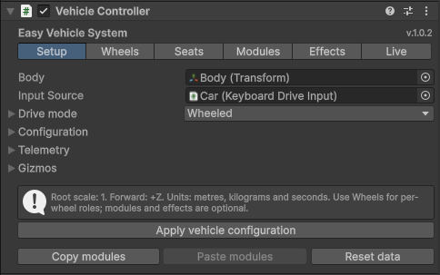

.. _uvs-index--ultra-vehicle-system:

Ultra Vehicle System
====================

Ultra Vehicle System is a modular vehicle package for Unity. It provides ready-to-use movement, physics and control systems for ground, air and water vehicles, with configurable passengers, interactive controls, damage and effects. Use it to build vehicles for your game with your own models, input and gameplay rules, or start from the supplied examples.

**Full documentation:** https://uvs.readthedocs.io/

**Youtube tutorials:** `Click here <https://www.youtube.com/watch?v=vm_SU-W8ODY>`__

.. _uvs-index--passenger-and-cockpit-walkthroughs:

Passenger and cockpit walkthroughs
----------------------------------

-  :ref:`Passengers <uvs-passengers--access-the-passenger-system-from-a-vehicle>`: ``vehicle.passengers``, controller choice and immediate occupancy.
-  :ref:`Boarding step by step <uvs-passengeraccess--tutorial-built-in-humanoid-boarding>`: built-in characters, profiles, doors, markers and lifecycle callbacks.
-  :ref:`Your own boarding motion <uvs-scripting-passengeraccess--tutorial-custom-motion-with-the-built-in-coordinator>`: custom adapters and complete application-owned alternatives.
-  :ref:`Seat Inspector and collision setup <uvs-seats--find-a-setting-in-the-seat-inspector>`: full setting paths, per-limb damage/release colliders, auto-eject and Undo.
-  :ref:`Handle setup <uvs-handles--tutorial-steering-wheel-with-independent-hand-ownership>`: steering, switches, pedals, Actions, contact and smooth returns.
-  :ref:`Your own contact <uvs-scripting-handles--tutorial-implement-your-own-contact>` and :ref:`control animator <uvs-scripting-interior--tutorial-author-your-own-model-motion>`: extension steps and compilable examples.

Paths use **Component > Header or foldout > Option**. Expand arrow groups; headings without arrows are visual separators. A placeholder such as **[limb]** means the selected Left Hand, Right Hand, Left Foot or Right Foot. API field names remain unchanged when the Inspector uses a shorter label.

.. _uvs-index--version-and-compatibility:

Version and compatibility
-------------------------

+------------------+----------------------------------------------------------------------------------------------------------+
| Item             | Support                                                                                                  |
+==================+==========================================================================================================+
| Version          | **1.0.2**                                                                                                |
+------------------+----------------------------------------------------------------------------------------------------------+
| Unity            | **Unity 6.0 LTS — 6000.0.84f1 or newer**                                                                 |
+------------------+----------------------------------------------------------------------------------------------------------+
| Render pipelines | **Built-in Render Pipeline, Universal Render Pipeline (URP) and High Definition Render Pipeline (HDRP)** |
+------------------+----------------------------------------------------------------------------------------------------------+
| Input            | Unity Input System **1.19.0**                                                                            |
+------------------+----------------------------------------------------------------------------------------------------------+

Vehicle mechanics are independent of the render pipeline. The supplied demo uses URP materials; for Built-in or HDRP, assign materials and shaders suitable for that pipeline to vehicles, water and effects. Installation keeps your project's render pipeline settings.

.. _uvs-index--key-features:

Key features
------------

-  **Ready-to-use vehicle physics and controllers.** Configure cars, buses, trucks, motorcycles, tracked vehicles and tanks, airplanes, aerobatic aircraft, jets, helicopters, drones, hover vehicles, boats and submarines. Built-in drive profiles provide movement and handling for each family, while your models define the vehicle's appearance.
-  **Modular design with custom extension points.** Combine only the mechanics and presentation systems your vehicle needs. Extend or replace built-in components, add your own modules, and create independent drive profiles that appear in the Inspector without modifying package code.
-  **A dedicated vehicle Inspector.** Configure the vehicle through grouped Setup, Wheels, Seats, Modules, Effects and Live views. Discover wheel colliders, assign wheel roles, inspect live state, preview supported poses, and copy or paste module configurations; custom subclasses retain their additional Inspector fields.
-  **Engine, transmission and driving assists.** Build a drivetrain with engine torque/RPM configuration, ignition and fuel, manual or automatic gearboxes, clutch, differential, traction control and stability assistance. Tune gearing, shift behavior and speed limits to suit the vehicle.
-  **Suspension, brakes and ground contact.** Configure spring and damper response, suspension travel, anti-roll support, steering geometry, service brakes and handbrakes. Add motorcycle balance, tracked steering, configurable surface grip, contact-envelope support and solid-tire helpers for the terrain your game uses.
-  **Flexible input and multiple movement modes.** Use keyboard controls, Input Actions, gamepads or external commands from AI, replay and application code. Register any number of drive profiles and cycle through them, select by ID, route input per mode and assign animated transitions to specific profile pairs. Configure and display speeds in km/h, mph or m/s.
-  **Drivers, passengers and interactive character controls.** Configure seats, boarding and exit points, animated or physical occupants, humanoid IK, hand grips and foot contacts. Add steering wheels, yokes, sticks and other handles, with configurable restraints, limb release and passenger ejection.
-  **Interactive interiors, body systems and aircraft equipment.** Add instrument readouts, HUDs, mirrors, lights, doors, moving body parts, windows, wipers, levers and pedals. Configure aircraft control surfaces, visible propellers/rotors, retractable landing gear and hinged gear suspension; connect trailers with towing and brake support.
-  **Damage, weapons and audiovisual effects.** Configure impacts, deformation of supported readable meshes, detachable parts and repair actions. Add aiming, projectiles, recoil, rockets and payload release, then combine engine and mechanical audio, tire smoke, skid marks, water effects and propulsion particles.
-  **Public APIs, events and ready-made examples.** Drive systems from your own scripts, read telemetry and react to typed events. Integrate custom input, components, characters and water providers using the API reference and complete C# examples. The Demo sample includes a selectable vehicle fleet and examples of the package's main systems.

.. _uvs-index--collision-presentation:

Collision presentation
----------------------

:doc:`Crash, contact and landing effects </DamageFeedback>`: impact strength, metallic scraping, wheel and suspension sounds, detached parts, sparks and configurable sound banks.

.. _uvs-index--local-documentation-formats:

Local documentation formats
---------------------------

Use **Markdown** for the source guides, **RTF** for formatted documents in Word or LibreOffice, or open **UltraVehicleSystem.pdf** for the complete manual with a clickable table of contents and bookmarks. The RTF folder contains standard ``.rtf`` files with headings, tables, lists and code examples. All formats are generated from the same Markdown source.

.. _uvs-index--start-building:

Start building
--------------

Read :doc:`Introduction and quick start </Introduction>` for the setup sequence and full guide index, or go directly to :doc:`Getting started </GettingStarted>`.

Explore the :doc:`demo vehicles </Demo>`, browse the :doc:`scripting reference </Scripting/index>` and :doc:`public API </API>`, or consult :doc:`Troubleshooting </Troubleshooting>`. See :doc:`Installation and included content </Distribution>` for import instructions and included folders.

.. _uvs-index--links:

Links
-----

-  GitHub, docs, issues, changelog: `Ultra Vehicle System on GitHub <https://github.com/szczyglis-dev/ultra-vehicle-system>`__
-  Documentation: `Online manual <https://uvs.readthedocs.io/>`__
-  License: `LICENSE.md <https://github.com/szczyglis-dev/ultra-vehicle-system/LICENSE.md>`__
-  Changelog: `CHANGELOG.md <https://github.com/szczyglis-dev/ultra-vehicle-system/CHANGELOG.md>`__

.. _uvs-index--author:

Author
------

Marcin Szczygliński (szczyglis83@gmail.com)

.. _uvs-index--demo-credits:

Demo credits
------------

Authors, licenses and available source URLs for the third-party models and audio used in the demo are listed in :doc:`Third-party credits </ThirdParty>`.

.. _uvs-index--complete-inspector-reference:

Complete Inspector reference
----------------------------

:doc:`All component settings </InspectorReference>` — descriptions, declared defaults, Inspector limits, inherited settings and nested configuration for every package system and the demo components.

Contents
========

.. toctree::
   :maxdepth: 1
   :caption: Getting started

   Introduction
   GettingStarted
   Demo
   VehicleModelConvention
   Configuration
   ModulesAndArchitecture
   InspectorConfiguration
   ChoosingSystems
   Input
   Cameras
   VehicleTuning
   Physics

.. toctree::
   :maxdepth: 1
   :caption: Driving and ground contact

   DriveProfiles
   Gearbox
   Clutch
   Differential
   TractionControl
   Suspension
   ContactEnvelope
   TireCollision
   Surfaces
   Tracked
   DrivingActions
   Towing
   CombinedVehicles

.. toctree::
   :maxdepth: 1
   :caption: Air and water vehicles

   Aircraft
   Boat
   Submarine
   Water

.. toctree::
   :maxdepth: 1
   :caption: Passengers and interactive controls

   Interior
   Passengers
   HumanAnatomy
   Seats
   Handles
   SteeringHandGrip
   HandPositions
   PassengerAccess
   InteriorControls
   ControlInteractions
   HandleAnimation
   InteriorSystems

.. toctree::
   :maxdepth: 1
   :caption: Body systems and effects

   MovingParts
   Lights
   Wipers
   Damage
   CollisionsAndStabilization
   DamageFeedback
   Audio
   Particles
   Decals
   Weapons

.. toctree::
   :maxdepth: 1
   :caption: Scripting and API

   Architecture
   Scripting
   Scripting/index
   Scripting/EventsReference
   API

.. toctree::
   :maxdepth: 1
   :caption: Reference and support

   SpeedUnits
   Performance
   Troubleshooting
   Distribution
   DemoResources
   ThirdParty
   Credits

.. toctree::
   :maxdepth: 1
   :caption: Inspector settings reference

   InspectorReference
